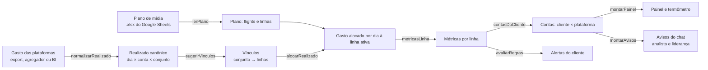

# Estrutura do monitor de pacing (v3)

Mapa do monitor de pacing de mídia paga da Ampla: as pastas, o caminho dos dados, os módulos, o
modelo de dados, as telas, os parâmetros e os testes. Para usar o monitor, veja o `README.md`; para
as regras de trabalho no código, o `CLAUDE.md`.

## Em uma frase

O monitor compara o gasto real das plataformas com a coluna **"Investimento Plataforma R$"** do
plano de mídia, linha a linha, e mostra numa tela só (o painel) se cada conta da Ampla está no
ritmo. Quando uma linha sai da margem perto do fim, o Google Chat avisa o analista e a liderança
direta. Ele é consultivo: só lê, não mexe nas plataformas, e não usa IA.

## Caminho dos dados



1. **Plano:** cada aba do .xlsx vira um flight; cada linha da tabela PLANO DE MÍDIA vira uma linha
   com período, plataforma e Investimento Plataforma (`plano.js`).
2. **Realizado:** o gasto chega num contrato único, uma linha por dia × conta × campanha × conjunto
   (`realizado.js`, `docs/CONTRATO_DADOS.md`). Recarregar o mesmo dia substitui, não duplica.
3. **Vínculos:** cada conjunto da plataforma é ligado a uma ou mais linhas do plano, por sugestão
   (código da turma, praça, produto, datas) ou à mão (`vinculo.js`, `docs/NOMENCLATURA.md`).
4. **Alocação:** o gasto de cada dia vai para a linha ativa naquele dia; o mesmo conjunto pode
   atravessar vários flights. Com duas linhas ativas no mesmo dia, rateia pela diária planejada.
5. **Pacing:** por linha, índice, saldo, média de 7 dias, diária necessária e projeção (`pacing.js`).
6. **Painel e avisos:** as linhas viram contas, as contas viram o painel, e as que estão fora da
   margem perto do fim viram mensagens para o Operações Bot (`painel.js`, `avisos.js`).

## Pastas e arquivos

```
monitor-pacing/
  index.html               página do monitor (carrega src/ui/app.js)
  teste-painel.html        página de teste "como ficaria" (carrega src/ui/teste.js)
  dist/                    as duas páginas em arquivo único, prontas para abrir no navegador
  src/
    core/                  lógica pura, sem DOM, testada em Node
    config/                parâmetros e textos editáveis pelo time de mídia
    ui/                    telas: HTML em string, CSS e eventos
    demo/                  dados de demonstração e cenários da página de teste
  tests/                   node --test (53 testes)
  tools/                   build, avisos em linha de comando, geração da demo e da fixture
  fixtures/                plano SEBRAE PE REV3 (.xlsx reconstruído) e realizado de exemplo (.csv)
  docs/                    contrato de dados, nomenclatura, regras, avisos e este mapa
```

### Núcleo (`src/core`)

| Arquivo | Faz | Principais funções |
|---|---|---|
| `format.js` | Dinheiro em centavos, datas ISO, formatação pt-BR | `paraCentavos`, `parseData`, `addDias`, `diasInclusivos`, `hojeSP`, `brl`, `pct` |
| `plano.js` | Lê o plano Ampla, valida (V1 a V13) e compara versões | `lerPlano`, `diffPlanos`, `rotuloLinha` |
| `realizado.js` | Lê CSV, reconhece nomes de coluna e mescla cargas | `lerCSV`, `normalizarRealizado`, `mesclarRealizado`, `entidadesDoRealizado`, `ultimaExtracao` |
| `vinculo.js` | Sugere vínculos e aloca o gasto por dia | `sugerirVinculos`, `aplicarSugestoes`, `alocarRealizado` |
| `pacing.js` | Métricas por linha e agregação | `metricasLinha`, `agregar`, `calcularTudo`, `classificar`, `series` |
| `regras.js` | Alertas do cliente e frescor dos dados | `avaliarRegras`, `aplicarDecisoes`, `frescorDosDados` |
| `cliente.js` | Tudo o que as telas de um cliente usam, de uma vez | `contextoCliente` |
| `painel.js` | Contas, painel, termômetro, margem dos avisos, ajuste diário ou total, equipe | `contasDoCliente`, `montarPainel`, `termometro`, `foraDaMargem`, `ajusteDaLinha`, `filtrarPainel`, `analistaDaConta`, `podeGerirEquipe` |
| `avisos.js` | Mensagens do Google Chat | `montarAvisos`, `textoLinha`, `linkDaConta` |
| `mock.js` | Realizado de demonstração, determinístico | `gerarRealizadoMock` |

### Configuração (`src/config`)

| Arquivo | Guarda |
|---|---|
| `config.js` | Faixas de status, margem e janela dos avisos, escala do termômetro, limiares das regras, comportamento das plataformas |
| `textos.js` | Textos dos alertas (R01 a R15) e das mensagens do chat, com os campos a preencher entre chaves |

### Interface (`src/ui`)

| Arquivo | Faz |
|---|---|
| `app.js` | Controlador do monitor: estado, importações, eventos, demonstração |
| `views.js` | Todas as telas e componentes (painel, termômetro, visão geral, equipe e avisos, alertas, vínculos, plano e dados) |
| `charts.js` | Gráficos com Chart.js (verba acumulada e gasto diário) |
| `storage.js` | Guarda o banco no navegador (`localStorage`) e exporta/importa o workspace .json |
| `teste.js` | Página de teste: cenários fictícios, roteiro conferido, associação de contas |
| `styles.css` | Estilo das duas páginas, temas claro e escuro, quadro escuro do painel |

### Demonstração (`src/demo`)

| Arquivo | Faz |
|---|---|
| `planoDemo.js` | Plano SEBRAE PE REV3 já lido (gerado por `tools/gerar_demo.mjs`) |
| `demoPainel.js` | Demonstração do monitor: SEBRAE PE e três clientes fictícios, com equipe fictícia |
| `cenarios.js` | Página de teste: 12 clientes fictícios, cenários "com problemas" e "tudo no ritmo", e a conferência de cada caso |

## Modelo de dados

Dinheiro sempre em **centavos inteiros**; datas sempre em texto **`AAAA-MM-DD`**, no fuso de São Paulo.

### Banco no navegador

Chave `ampla-monitor-pacing:v1` no `localStorage`:

```
{
  versao, clienteAtivo,
  clientes:     { [clienteId]: Workspace },
  equipe:       { pessoas: [ { nome, email, lider, lideranca } ] },
  preferencias: { usuario, filtroPainel, linkPainel }
}
```

### Workspace (um por cliente)

| Campo | O que é |
|---|---|
| `clienteId`, `cliente` | Identificador e nome do cliente |
| `analista` | E-mail do analista padrão do cliente |
| `analistaPorConta` | `{ [plataforma]: email }`: analista de uma conta específica, se diferente do padrão |
| `planos`, `planoAtivo` | Até 5 versões do plano e qual está valendo |
| `realizado` | Registros do contrato de dados |
| `vinculos` | `{ [chave do conjunto]: { linhas, pesos?, origem, confianca?, confirmadoEm } }` |
| `decisoes`, `justificativas`, `notas` | O que o analista registrou nos alertas e nas linhas |
| `config` | Ajustes do cliente sobre `CONFIG_PADRAO` |
| `historico` | Importações e cargas, com data |

### Plano, flight e linha

- **Plano:** `id`, `cliente`, `clienteId`, `arquivo`, `versao` (REV), `flights`, `linhas`, `avisos` (validações).
- **Flight:** uma aba: `id`, `aba`, `inicio`, `fim`, `linhaIds`, `investimento`.
- **Linha:** `id`, `flightId`, `aba`, `plataforma`, `produto`, `praca`, `codigoRaw`, `codigosTurma`,
  `inicio`, `fim`, `dias` (contagem inclusiva), **`investimento`** (a coluna Investimento Plataforma),
  `diariaPlan` (investimento ÷ dias).

### Registro do realizado

`data`, `plataforma`, `contaId`, `contaNome`, `campanhaId`, `campanhaNome`, `conjuntoId`,
`conjuntoNome`, `moeda`, `gasto`, `orcamentoDiario`, `tipoOrcamento`, `statusEntrega`,
`dataExtracao` (e métricas de resultado, que o painel não usa). Chave do conjunto:
`plataforma|contaId|campanhaId|conjuntoId`.

### Métricas de uma linha (`metricasLinha`)

| Campo | Cálculo |
|---|---|
| `situacao` | `agendada`, `ativa` ou `encerrada` na data de referência |
| `planejadoAteOntem` | diária planejada × dias fechados (o dia de referência é parcial e fica fora) |
| `gasto` | gasto alocado até ontem |
| `indice` | gasto ÷ planejado até ontem (1,00 = no ritmo) |
| `saldo` | investimento − gasto |
| `media` | média dos últimos 7 dias fechados |
| `diariaNecessaria` | saldo ÷ dias restantes |
| `projecaoFim` | gasto + média × dias restantes |
| `diasRestantes` | de hoje ao fim da linha, contando hoje |
| `status` | no ritmo até ±10%, atenção até ±20%, crítico acima; sem veiculação depois de D+3 sem gasto |

### Conta (`contasDoCliente`)

Uma conta = cliente × plataforma. Soma as linhas **em veiculação** e traz: `analista` (o da conta
ou o padrão do cliente), `investimento`, `planejadoAteOntem`, `gasto`, `indice`, `oscilacao` (índice
de hoje − de ontem), `desvio`, `sentido` (acima, abaixo, no ritmo), `projecaoFim`, `proximoFim`,
`diasParaFim`, `desatualizado` e `fora` (as linhas que geram aviso, cada uma com o ajuste a fazer).

### Aviso (`montarAvisos`)

```
{ avisos: [ { para, nome, papel: 'analista' | 'lideranca', texto, contas, linhas } ],
  semResponsavel: [contas fora da margem sem analista],
  desatualizadas: [contas em veiculação com dado atrasado] }
```

## Regras centrais

| Regra | Valor | Onde |
|---|---|---|
| Valor monitorado | Coluna "Investimento Plataforma R$"; a cascata e os totais da planilha são só conferência | `plano.js` |
| Dia de referência | Parcial: não entra em gasto acumulado, médias nem projeções | `pacing.js` |
| Status da linha | No ritmo até ±10%; atenção até ±20%; crítico acima | `config.status` |
| Aviso no chat | Linha em veiculação, fora de ±10% e a 10 dias ou menos do fim, com dado em dia | `foraDaMargem`, `config.avisos` |
| Dado desatualizado | Falta o dia anterior a ontem ou extração com mais de 36 horas: sem aviso e fora do termômetro geral | `frescorDosDados` |
| Ajuste recomendado | Orçamento diário: a diária necessária. Orçamento total: gasto dos conjuntos + saldo. Sem tipo: os dois. Verba consumida: pausar | `ajusteDaLinha` |
| Termômetro | (usado − previsto até ontem) ÷ diária planejada, em dias de verba; régua de −30% a +30% do previsto | `termometro`, `config.termometro` |
| Só pacing | Regras de KPI (R06, R07, R07b) ficam fora das telas e dos avisos | `config.regrasDeKpi`, `soPacing` |
| Recomendação executável | Toda ação traz entidade, número, ação e prazo | `textos.js`, testes |

### Alertas do cliente (`regras.js`)

| Regra | Dispara quando |
|---|---|
| R01 · Abaixo do ritmo | Linha ativa abaixo da margem |
| R02 · Acima do ritmo | Linha ativa acima da margem |
| R03 · Ritmo recente acelerou | No ritmo, mas a média recente esgota a verba antes do fim |
| R04 · Sem veiculação | Sem gasto depois de D+3 do início |
| R05 · Gasto fora do período | Conjunto gastando fora das linhas vinculadas |
| R05b · Depois do início da turma | Gasto depois da data da turma |
| R08 · Gasto sem vínculo | Conjunto sem linha do plano |
| R09 · Gasto concentrado | Um conjunto com mais de 80% e outro parado |
| R10 · Picos diários | 2 dias ou mais, nos últimos 7, acima de 150% da diária |
| R11 · Over / entrega limitada | Gasto acima do orçamento configurado, ou abaixo de 50% dele por 3 dias |
| R12 · Remanejamento | Sobra projetada numa linha e outra no ritmo, no mesmo flight e produto |
| R13 · Dados desatualizados | Extração com mais de 36 horas (suspende as regras de ritmo) |
| R14 · Desvio sem justificativa | Desvio acima de ±10% sem causa registrada |
| R15 · Orçamento diferente do plano | Diárias configuradas diferem da necessária em mais de 10% |

Detalhes em `docs/REGRAS.md`.

## Telas

| Tela | Como chega | Mostra |
|---|---|---|
| Painel | Menu | Todas as contas, como uma MCC: cliente › contas por plataforma. Placar, termômetro geral, filtros "Contas de", "Time de", cliente, plataforma e situação, botão "Visão geral" por cliente e por conta |
| Equipe e avisos | Menu (só liderança) | Responsável por conta, cadastro da equipe, link do monitor e prévia das mensagens do dia |
| Visão geral | Botão no painel | Investimento, usado, termômetro, projeção, régua de consumo, gráfico de verba acumulada e linhas em veiculação |
| Detalhes da linha | Botão "Detalhes" na visão geral | Gráficos, conjuntos, alertas, justificativa e notas da linha |
| Alertas | Menu do cliente | Alertas de pacing com ação, valor e prazo; aceitar, adiar ou descartar |
| Vínculos | Menu do cliente | Conjuntos × linhas do plano, sugestões e vínculo manual |
| Plano e dados | Menu do cliente | Flights, validações do plano, realizado carregado, exportar e importar workspace |

"Você é", no topo, identifica a pessoa: o painel abre na carteira dela, e a área Equipe e avisos só
abre para a liderança. Sem login, esse bloqueio evita engano, mas não é controle de acesso.

## Parâmetros (`src/config/config.js`)

| Parâmetro | Padrão | Efeito |
|---|---|---|
| `status.noRitmo` | 0,10 | Faixa "no ritmo" do status da linha |
| `status.atencao` | 0,20 | Acima disso, crítico (e "muito" no termômetro) |
| `avisos.margem` | 0,10 | Margem dos avisos e do sentido das contas |
| `avisos.diasParaFim` | 10 | Janela final em que a linha fora da margem gera aviso |
| `avisos.linkPainel` | vazio | Link do monitor citado na mensagem (também editável na tela) |
| `termometro.escala` | 0,30 | Extensão da régua do termômetro, para cada lado |
| `diasSetup` | 3 | Dias até uma linha sem gasto virar "sem veiculação" |
| `janelaMediaDias` | 7 | Janela da média usada nas projeções |
| `regras.dadosDesatualizadosHoras` | 36 | Idade máxima da extração |
| `regrasDeKpi` | R06, R07, R07b | Regras escondidas (o monitor é só de pacing) |

## Comandos e saídas

| Comando | Faz |
|---|---|
| `npm test` | Roda os 53 testes do núcleo e dos cenários |
| `npm run build` | Gera `dist/monitor-pacing.html` e `dist/teste-painel.html` |
| `npm run dev` | Servidor local na porta 5173 |
| `node tools/avisos.mjs workspace.json [--ref AAAA-MM-DD] [--link URL]` | Avisos do dia em JSON, para o Operações Bot |
| `node tools/gerar_demo.mjs` | Regenera `src/demo/planoDemo.js` a partir da fixture |
| `python3 tools/gerar_fixture_sebrae.py` | Regenera a fixture .xlsx |

O workflow `.github/workflows/monitor-pacing.yml` roda testes e build a cada mudança em `monitor-pacing/`.

## Testes

| Arquivo | Cobre |
|---|---|
| `format.test.js` | Números, centavos, datas, contagem inclusiva, códigos de turma |
| `plano.test.js` | Leitura do plano SEBRAE, validações e diferença entre versões |
| `realizado.test.js` | CSV, nomes de coluna, carga sem duplicar |
| `vinculo.test.js` | Sugestões e alocação por dia entre flights |
| `pacing.test.js` | Índice, projeções, faixas de status, séries |
| `regras.test.js` | Alertas esperados e "toda recomendação é executável" |
| `painel.test.js` | Contas, margem, termômetro, ajuste diário ou total, avisos, liderança, responsável por conta, dado desatualizado |
| `cenarios.test.js` | Cada caso do roteiro da página de teste; cenário "tudo no ritmo" sem nenhum aviso |

## Dependências

O app usa só Chart.js 4.4.1 e SheetJS 0.18.5, via cdnjs. Para testes e build: `xlsx` e `esbuild`.

## Decisões pendentes

Conector do BI · armazenamento compartilhado · entrega dos avisos pelo Operações Bot · login e origem
do cadastro de equipe · aprovação da nomenclatura · escopo do remanejamento (R12) · validação dos
limites de entrega das plataformas · meta do Acréscimo · IA opcional.
